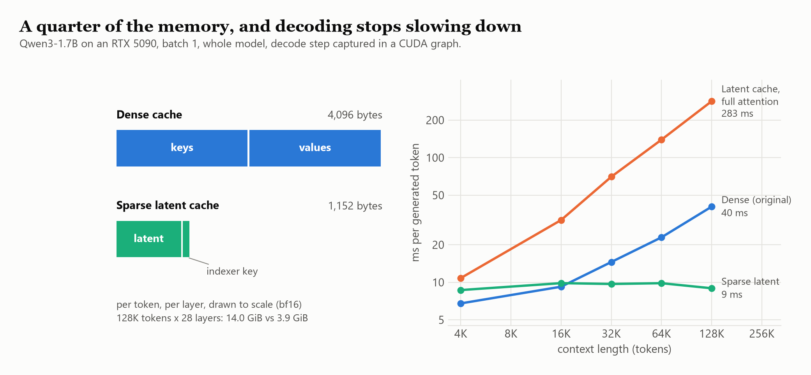
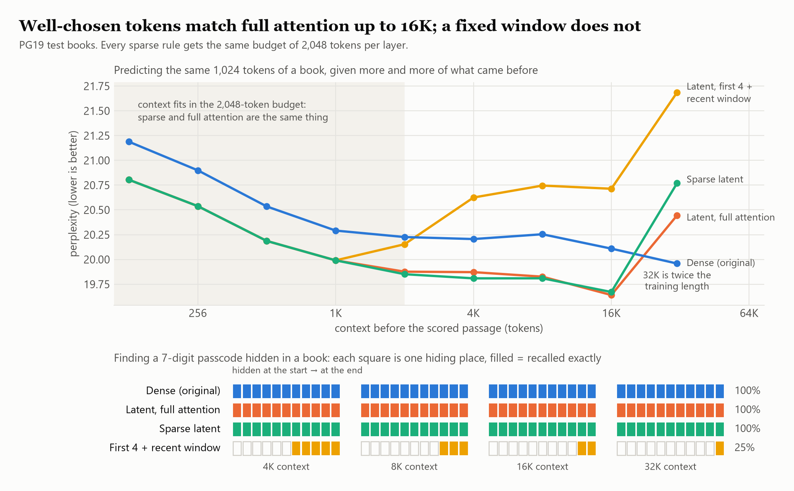
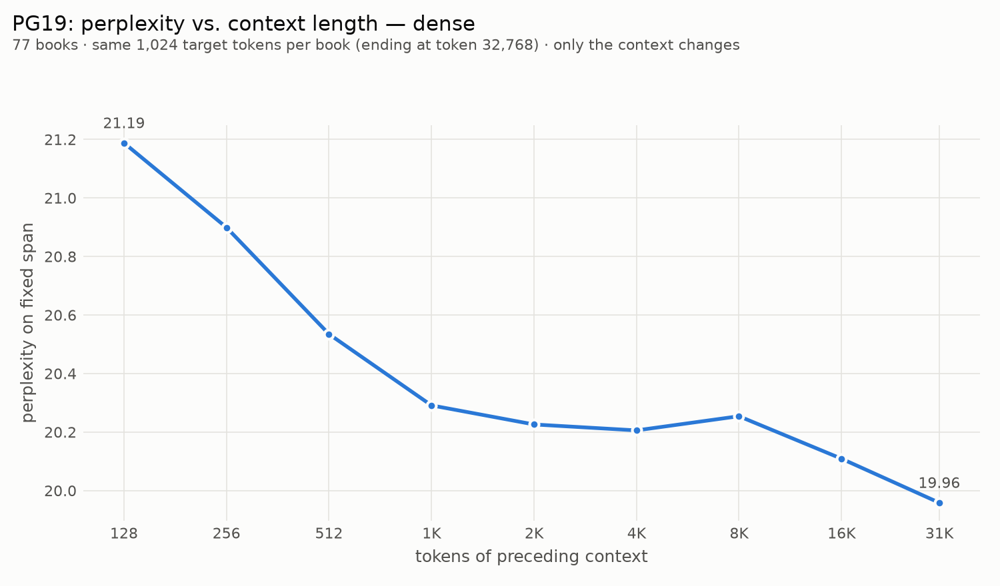
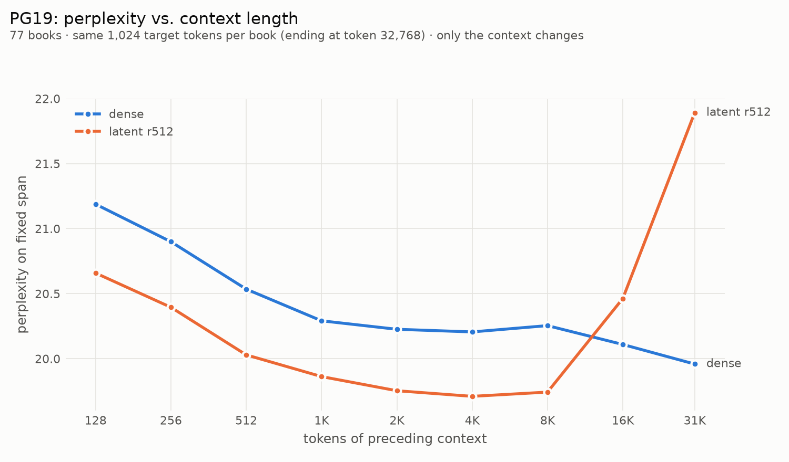

# sparse-latent-attention

A clean, native-PyTorch reimplementation of sparse attention driven by a
lightning indexer distilled from dense attention (DeepSeek Sparse Attention style).

## Status

- [x] Qwen3-1.7B reimplemented from scratch in plain torch (`src/sla/model.py`)
- [x] KV-cache generation (`src/sla/generate.py`)
- [x] Sliding-window perplexity eval (`src/sla/perplexity.py`)
- [x] Training data: 99M tokens, PG19-train + FineWeb-Edu, packed at 4K (`scripts/prepare_data.py`)
- [x] MLA-style latent KV conversion: PCA init + logit distillation (`src/sla/latent.py`, `scripts/train_latent.py`)
- [x] Long-context (16K) latent distillation
- [x] Lightning indexer + per-layer KL distillation (`src/sla/sparse.py`, `scripts/train_indexer.py`)
- [x] Top-k sparse attention (torch reference) with forced sink + local tokens
- [x] Fused Triton decode kernels: indexer scores + gather/expand/k_norm/RoPE/attention (`src/sla/kernels.py`)
- [x] Evals: PG19 ppl vs. context, indexer recall, needle-in-a-haystack, decode latency
- [ ] Sparse prefill kernel, top-k kernel, RULER / LongBench

**Write-up:** [`writeup/sparse-latent-attention.md`](writeup/sparse-latent-attention.md)

## Usage

```bash
uv sync
uv run pytest                                   # matches HF reference (fp32 max |dlogit| ~4e-5)
uv run python scripts/generate.py "Your prompt"
uv run python scripts/eval_ppl.py --context-lens 512 2048 4096 8192 16384 32768

# sparse latent attention pipeline
uv run python scripts/train_latent.py --seq-len 16384 --data data/mix_16k --init-latent checkpoints/latent_r512/latent.pt --grad-ckpt --steps 300 --out checkpoints/latent_r512_16k
uv run python scripts/train_indexer.py            # -> checkpoints/indexer/indexer.pt, results/indexer_recall.json
uv run python scripts/eval_pg19.py --attn sdpa --latent checkpoints/latent_r512_16k/latent.pt --indexer checkpoints/indexer/indexer.pt --out results/pg19_sparse_latent.json
uv run python scripts/eval_niah.py --latent checkpoints/latent_r512_16k/latent.pt --indexer checkpoints/indexer/indexer.pt --out results/niah_sparse_latent.json
uv run python scripts/bench_decode.py             # -> results/bench_decode.json (per-layer attention)
uv run python scripts/bench_e2e.py                # -> results/bench_e2e.json (whole model + memory)
uv run python scripts/selection_map.py           # -> results/selection_map.json (which tokens each layer reads)
uv run python scripts/plot_results.py             # -> results/figures/
```

## Sparse latent attention — headline results

Latent KV (rank 512) + lightning indexer (8 heads × 64) selecting k = 2,048
tokens per query (4 sinks + 128 recent always kept). Cache: 1,152 B/token/layer
vs 4,096 dense (3.6× smaller).

| | dense | latent (full attn) | **sparse latent** | latent, sink+window |
|---|---|---|---|---|
| PG19 ppl @ 4K / 16K context | 20.21 / 20.11 | 19.87 / 19.64 | **19.81 / 19.67** | 20.62 / 20.71 |
| NIAH, 4K–32K | 100% | 100% | **100%** | 25% |
| attention mass kept (k = 2K) | — | — | **95.8%** (oracle 97.0%) | 92.6% |
| decode attn / layer @ 128K | 1.13 ms | 8.41 ms | **0.19 ms** (Triton) | — |
| whole model, ms/token @ 128K (CUDA graphs) | 40.4 | 283 | **9.0** | — |
| KV cache @ 128K | 14.0 GiB | 3.5 GiB | **3.9 GiB** | — |




## Dense baseline — Qwen3-1.7B, bf16, WikiText-2 test (non-overlapping windows)

| context | ppl    | time (RTX 5090) | peak mem |
|--------:|-------:|----------------:|---------:|
|     512 | 21.685 |   15 s |  3.8 GiB |
|   2,048 | 16.726 |   17 s |  4.7 GiB |
|   4,096 | 15.683 |   26 s |  5.8 GiB |
|   8,192 | 15.127 |   46 s |  6.9 GiB |
|  16,384 | 14.668 |   87 s |  7.1 GiB |
|  32,768 | 14.325 |  174 s |  7.4 GiB |

Cross-check: HF `transformers` (bf16, SDPA) gives 15.681 at 4,096.

## Dense baseline — PG19 test, perplexity vs. context (`scripts/eval_pg19.py`)

Same 1,024 target tokens per book (ending at token 32,768; 77 books ≥ 32K
tokens), scored with increasing preceding context — only the context changes.

| context | 128 | 256 | 512 | 1K | 2K | 4K | 8K | 16K | 31K |
|---|---|---|---|---|---|---|---|---|---|
| ppl | 21.19 | 20.90 | 20.54 | 20.29 | 20.23 | 20.21 | 20.25 | 20.11 | 19.96 |



Note: a naive loss-vs-position curve (`--by-position`) *rises* with position,
because book openings (credits, title pages, contents) are easy to predict —
position is confounded with content. Hence the fixed-span design.

## Latent KV (MLA conversion)

Each layer's keys and values (2 × 8 KV heads × 128 = 2,048 values/token) are
replaced by a joint latent `c = W_down x` of rank r (the only thing cached);
`[k; v] = W_up c`, then k_norm and RoPE as before. Initialised from PCA of real
K/V activations (256K calibration tokens), then distilled: frozen model, only
W_down / W_up trained, KL(teacher ‖ student) on next-token distributions, where
the teacher is the same weights on the original attention path.

**PCA alone is not enough** (WikiText-2 ppl @ 4K, dense = 15.68):

| rank (cache reduction) | plain PCA | K/V-balanced | importance-weighted |
|---|---|---|---|
| 1024 (2×)  | 20.1   | 27.9   | 35.1   |
| 768 (2.7×) | 56.1   | 171.9  | 139.4  |
| 512 (4×)   | 1,727  | 2,848  | 1,229  |
| 256 (8×)   | 5,792  | 7,555  | 6,898  |

Diagnosis at rank 512 (plain PCA, 41K-token WikiText subset where dense = 15.29):
compressing any *single* layer barely matters (ppl ≈ 15.3
for most; layers 0 and 20 are the sensitive ones at 17.5 / 22.2), but errors
compound across 28 layers. Keys are far more fragile than values
(K-only 141 vs V-only 25.6). Distillation fixes this fast: 30 steps (~1M tokens)
take rank 512 from 1,229 → 16.9.

**After 1,000 steps (33M tokens, 4K sequences, ~85 min on a 5090):**

| | dense | latent r512 |
|---|---|---|
| WikiText-2 ppl @4K | 15.68 | 15.02 |
| val ppl (T = 1) | 18.76 | 18.56 |
| val ppl at best temperature | **16.18** (T=1.3) | 16.63 (T=1.2) |
| val entropy (nats) | 1.75 | 1.88 |

The student "beating" the teacher at T = 1 is a calibration artefact: the
post-trained teacher is overconfident on raw text and KL(teacher‖student) makes
the student broader. At each model's best temperature the latent model is ~3% worse.



Long context breaks past the training length: the latent model tracks dense up to
8K but degrades at 16K (20.46) and 32K (21.89) where dense keeps improving
(19.96). Chat generation also degrades (ignores instructions, stray `</think>`),
since training used raw text only. Long-sequence (16K) training since fixed the
context degradation up to 16K (see above); chat data is still not in the mix.
